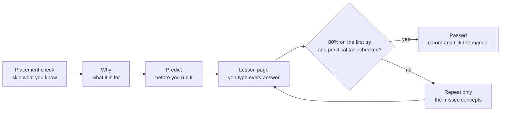

# Socrates

**A Socratic tutor and lesson generator for any AI model.** Socrates is an agent skill that turns your AI assistant into a private tutor. It teaches the skills your own projects need, one lesson at a time. It asks before it explains, holds back answers until you have really tried, generates an interactive lesson page for every lesson, and keeps your progress in plain Markdown notes that you own.

It is written as a model-agnostic [Agent Skill](https://agentskills.io): one `SKILL.md` file that any capable model and any agent runtime that reads skills can follow.

## How a lesson works

- **Questions first.** You predict what a command will print before you run it. A wrong prediction is material, not failure.
- **No answers on a plate.** When you are stuck, the tutor asks a smaller question or points at what you are missing. It gives the answer only after a real attempt, and then explains why.
- **Placement check.** Five short questions at the start of a track skip what you already know.
- **One concept per lesson,** ending in a small practical task on a real project of yours, so knowledge is proven, not just read.
- **Lesson pages.** Each lesson is generated as an interactive page of numbered tasks. You type every command and answer; the page scores your first try and gives you a result line to paste back.
- **A strict pass mark.** 80% on the first try plus a checked practical task. Below that, only the missed concepts repeat, with new questions.
- **Your progress is yours.** Every lesson is recorded with a six-part trace (source, exercise, result, test, lesson, next application) and ticked off in a manual of chapters, all in plain Markdown.

## Try the example

Open [`examples/python-division-room.html`](examples/python-division-room.html) in a browser (download it, then double-click it). It is a finished lesson on Python division and remainders: five tasks, seven scored questions, a practical task and flashcards. Every answer was checked in Python.

## Install

1. Copy the `skills/socrates/` folder into the folder your agent runtime reads skills from (for example `.agents/skills/` or `.claude/skills/` in your project).
2. Copy the four notes in `skills/socrates/records/` into a `learning/` folder in your project, and rename "Example track" to your first track.
3. Start a message with **Socrates**, or ask for a lesson, an exercise or a test.

No runtime that reads skills? Paste the contents of `SKILL.md` at the start of a chat with any capable model, and attach the template when you want lesson pages.

## What is in this repository

| Path | What it is |
| --- | --- |
| `skills/socrates/SKILL.md` | The skill: when it starts, the lesson loop, the pass rule, the page rules, safety and records |
| `skills/socrates/lesson-template.html` | The lesson page template: one self-contained HTML file, no libraries, no network |
| `skills/socrates/records/` | Blank learning index, curriculum, manual and learning record |
| `examples/python-division-room.html` | A finished example lesson page |

## Design notes

- **Self-contained pages.** A lesson page is a single HTML file with no external requests. Progress is kept in the browser's local storage on that device only.
- **Easy on the eyes.** A soft dim colour scheme with no pure black or white, text at 16px or larger and every text pair between 4.5:1 and 12:1 contrast. Change the colours through the `--cf-` variables at the top of the template.
- **Accessible.** Every control works with a keyboard, results are text labels as well as colours, and the page reads at phone width.
- **Commands are typed, never copied.** The page offers no copy button for commands on purpose.

## Origin

Socrates was first built in November 2026 as part of FRACT, a personal knowledge and agent system. A smaller version also ships in [fract-starter](https://github.com/mafasak1ng/fract-starter); this repository is the full, standalone edition.

## Licence

[MIT](LICENSE)
